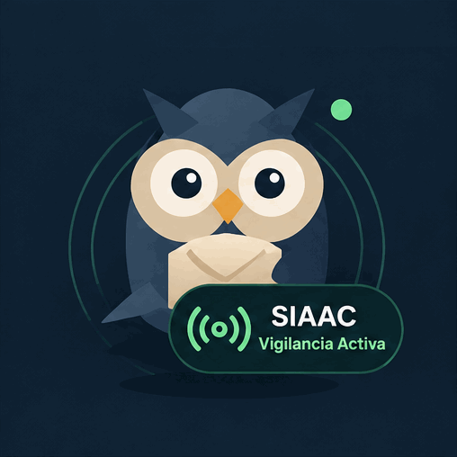
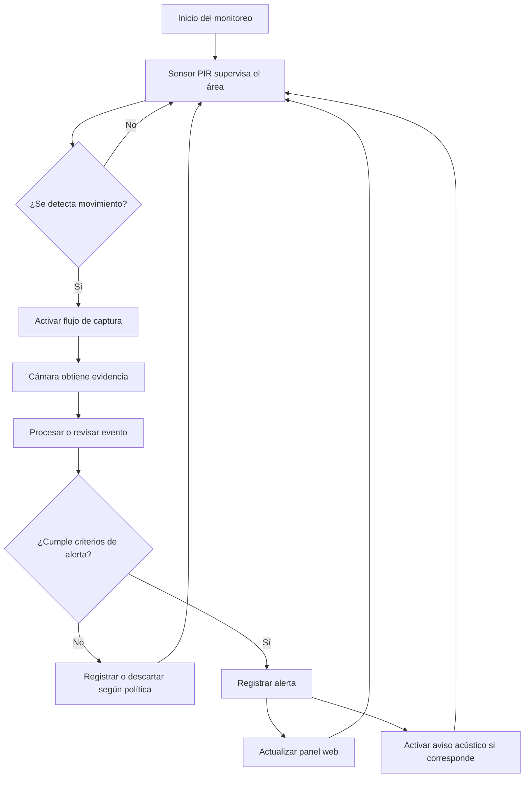
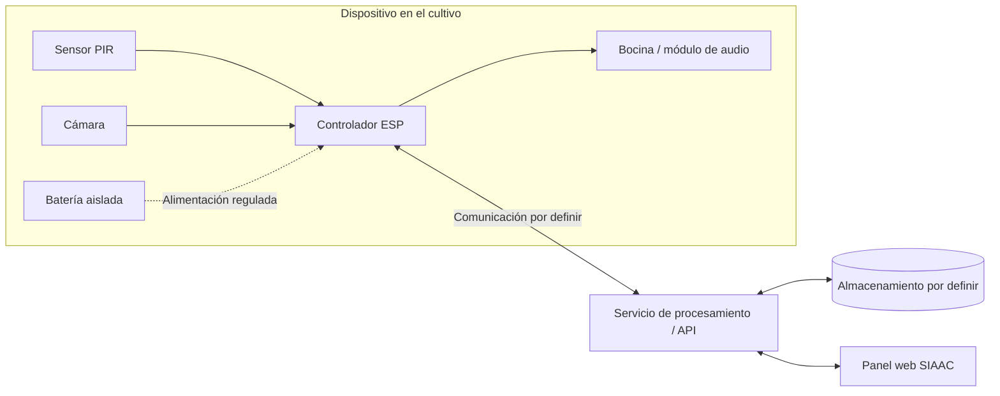

<div align="center">

# 🦉 SIAAC | Vigilancia inteligente de cultivos

### Sistema de monitoreo, detección y alertas para la protección de cultivos


<br />



<br />


[](https://github.com/diegoih23/SIAAC_UNL)
[](https://github.com/diegoih23/SIAAC_UNL/tree/Juan)
[](https://github.com/diegoih23/SIAAC_UNL/issues)
[](https://github.com/diegoih23/SIAAC_UNL/commits)

**Universidad Nacional de Loja · Carrera de Computación**

</div>

---

> [!IMPORTANT]
> **Estado de la documentación:** esta guía reúne el contexto funcional y el diseño planteado para SIAAC. La estructura exacta del código, las dependencias, los comandos de inicio y la implementación efectiva **requieren contrastarse con la rama del repositorio**. No se presentan como implementadas funciones que aún no se han verificado.

## 📌 Vista general

| Aspecto | Descripción |
|---|---|
| 🦉 Proyecto | SIAAC |
| 🎯 Propósito | Apoyar la vigilancia de cultivos y generar alertas ante eventos detectados |
| 🖥️ Interfaz | Panel web de monitoreo y control |
| 📷 Captura | Cámara integrada al sistema de vigilancia (modelo por confirmar) |
| 🚶 Detección | Sensor PIR de movimiento |
| 📢 Respuesta | Bocina o dispositivo acústico de aviso/disuasión |
| 🔌 Control | Plataforma ESP (modelo definitivo por confirmar) |
| 🔋 Energía | Batería reemplazable en compartimento separado |
| 🌦️ Instalación | Gabinete protegido frente a condiciones ambientales |
| 🏗️ Fase | Desarrollo e integración; funcionalidades por validar |

## 🧭 Navegación rápida

- [🌱 ¿Qué es SIAAC?](#-qué-es-siaac)
- [✨ Funcionalidades](#-funcionalidades-y-alcance)
- [🔄 Flujo de funcionamiento](#-flujo-de-funcionamiento)
- [🏗️ Arquitectura](#️-arquitectura-propuesta)
- [🧩 Componentes físicos](#-componentes-físicos)
- [🖥️ Interfaz web](#️-interfaz-web)
- [🚀 Instalación y ejecución](#-instalación-y-ejecución)
- [🧪 Verificación y pruebas](#-verificación-y-pruebas)
- [🗺️ Hoja de ruta](#️-hoja-de-ruta)
- [🛠️ Problemas frecuentes](#️-problemas-frecuentes)
- [🤝 Colaboración](#-colaboración)

---

<details open>
<summary><h2>🌱 ¿Qué es SIAAC?</h2></summary>

**SIAAC** es un proyecto académico orientado al monitoreo de cultivos mediante una combinación de **sensores, cámara, electrónica de control y una aplicación web**. La propuesta busca identificar actividad en un área vigilada, procesar los eventos y facilitar una respuesta de alerta o disuasión, según la lógica que se implemente.

### Problema que aborda

La vigilancia continua de áreas de cultivo puede requerir presencia humana y revisiones frecuentes. SIAAC explora una alternativa de apoyo tecnológico para detectar eventos y permitir su seguimiento desde una interfaz centralizada.

### Objetivos

1. Detectar movimiento mediante un sensor PIR.
2. Incorporar captura visual para apoyar la identificación o revisión de eventos.
3. Comunicar eventos a una interfaz de monitoreo.
4. Gestionar un aviso acústico mediante una bocina, sujeto a reglas de activación.
5. Diseñar un dispositivo mantenible, con protección ambiental y batería de fácil sustitución.

> [!NOTE]
> La detección PIR indica movimiento o cambios térmicos; **por sí sola no identifica animales, personas ni el tipo de amenaza**. Cualquier clasificación visual deberá implementarse y evaluarse por separado.

</details>

<details>
<summary><h2>✨ Funcionalidades y alcance</h2></summary>

| Funcionalidad | Alcance previsto | Validación |
|---|---|---|
| 🔐 Acceso a la plataforma | Pantalla de ingreso y acceso al centro de control | Por comprobar en código |
| 📊 Panel de vigilancia | Consultar estado general del sistema | Por comprobar |
| 🚶 Detección PIR | Identificar movimiento en el área supervisada | Integración por verificar |
| 📷 Cámara | Obtener imágenes o video para análisis | Integración por verificar |
| 🔎 Análisis visual | Interpretar eventos capturados | Algoritmo y precisión por definir |
| 📢 Bocina | Emitir avisos acústicos bajo condiciones definidas | Integración por verificar |
| 🟢 Estado de vigilancia | Mostrar actividad del dispositivo | Sincronización real por verificar |
| 📜 Historial | Consultar registros de detección | Persistencia por verificar |
| 🔔 Notificaciones | Informar eventos relevantes | Canal y reglas por definir |
| 🌦️ Protección física | Resguardar electrónica en exteriores | Diseño y pruebas por completar |

**Importante:** una pantalla diseñada o un prototipo visual no equivale a una función conectada y operativa.

</details>

<details>
<summary><h2>🔄 Flujo de funcionamiento</h2></summary>



> [!WARNING]
> Este diagrama representa el **flujo objetivo**, no una certificación de que todos sus pasos estén programados. Deben definirse los criterios de alerta, las condiciones de activación de la bocina y el manejo de falsos positivos.

</details>

<details>
<summary><h2>🏗️ Arquitectura propuesta</h2></summary>



### Responsabilidades de cada capa

| Capa | Responsabilidad |
|---|---|
| Dispositivo | Adquirir señales, capturar información y ejecutar acciones autorizadas |
| Comunicación | Transportar eventos entre el dispositivo y la plataforma |
| Procesamiento | Aplicar reglas, analizar eventos y coordinar respuestas |
| Persistencia | Guardar registros, configuración y evidencia según requisitos |
| Web | Presentar estado, eventos y opciones de control |

**Decisiones pendientes:** protocolo de comunicación, backend, base de datos, modelo de cámara, método de análisis visual y estrategia de despliegue.

</details>

<details>
<summary><h2>🧩 Componentes físicos</h2></summary>

| Componente | Función | Consideración de diseño |
|---|---|---|
| Controlador ESP | Coordinar sensores, comunicación y salidas | Confirmar modelo, pines y consumo |
| Sensor PIR | Detectar movimiento | Ubicación y orientación para reducir falsas alarmas |
| Cámara | Capturar el área vigilada | Campo de visión, iluminación y compatibilidad |
| Bocina | Emitir aviso audible | Requiere circuito de manejo adecuado y niveles seguros |
| Batería | Suministrar energía | Compartimento separado, protegido y accesible |
| Gabinete | Proteger el equipo | Resistencia a lluvia, polvo y condensación |
| Conectores y alimentación | Distribuir energía y señales | Protección eléctrica y mantenimiento sencillo |

### Criterios del prototipo

- **No se incorpora micrófono** al diseño previsto.
- La **batería debe permanecer separada** del resto de los módulos y poder retirarse para mantenimiento.
- El **sensor PIR debe quedar incluido** en el esquema y en el diseño final.
- El gabinete debe proteger la electrónica sin bloquear el campo de visión de la cámara ni la zona de detección del PIR.
- La integración física debe revisarse antes de cualquier prueba en exteriores.

> [!CAUTION]
> La selección de batería, carga, aislamiento, alimentación y sellado debe revisarse con supervisión técnica. No se deben conectar directamente módulos de potencia sin verificar especificaciones y protecciones.

</details>

<details>
<summary><h2>🖥️ Interfaz web</h2></summary>

La identidad visual propuesta para SIAAC utiliza una paleta **azul oscuro y verde**, acompañada de un **búho** como mascota de vigilancia.

### Pantalla de bienvenida

- Identidad gráfica y mascota de SIAAC.
- Mensaje principal: **«Inicia tu vigilancia»**.
- Acceso al centro de control de cultivos.
- Indicador visual de **vigilancia activa**.
- Control visual de apariencia (según el prototipo mostrado).

### Panel de control: contenido objetivo

- Estado del dispositivo y conectividad.
- Estado de sensores y cámara.
- Eventos recientes y alertas.
- Opciones de supervisión y configuración.
- Historial y evidencia, si se implementa su almacenamiento.

> [!TIP]
> El indicador «vigilancia activa» debería reflejar **telemetría real del dispositivo**, no solamente un estado visual del frontend.

</details>

<details open>
<summary><h2>🚀 Instalación y ejecución</h2></summary>

### 1. Obtener el código

```bash
git clone --branch Juan https://github.com/diegoih23/SIAAC_UNL.git
cd SIAAC_UNL
```

Para conocer la estructura real:

```bash
ls -la
find . -maxdepth 2 -type f \
  -not -path './.git/*' | sort | head -100
```

### 2. Identificar el entorno de ejecución

La tecnología exacta del repositorio **no se ha podido verificar**. Antes de instalar paquetes, identifica los archivos presentes:

| Archivo encontrado | Indicio | Acción |
|---|---|---|
| `package.json` | Proyecto JavaScript/Node | Revisar `scripts` y dependencias |
| `vite.config.*` | Posible frontend Vite | Verificar script de desarrollo |
| `requirements.txt` | Dependencias Python | Preparar entorno virtual |
| `pyproject.toml` | Proyecto Python | Revisar gestor de dependencias |
| `manage.py` | Posible proyecto Django | Revisar configuración del servidor |
| `platformio.ini` | Firmware PlatformIO | Abrir proyecto en PlatformIO |
| `*.ino` | Firmware Arduino | Abrir con Arduino IDE |
| `docker-compose.yml` / `compose.yaml` | Servicios en contenedores | Revisar servicios y variables |
| `.env.example` | Configuración de entorno | Copiar y completar variables necesarias |

### 3. Ejecutar el frontend, si utiliza Node.js

Entra **en el directorio que contenga `package.json`** y revisa los scripts:

```bash
npm install
npm run
```

Si aparece el script `dev`:

```bash
npm run dev
```

> La URL y el puerto son los que indique la terminal; no se presupone un puerto fijo.

### 4. Ejecutar un servicio Python, si existe

Entra **en el directorio del servicio Python**. Si utiliza `requirements.txt`:

```bash
python3 -m venv .venv
source .venv/bin/activate
python -m pip install -r requirements.txt
```

En Windows, activa el entorno con `.venv\Scripts\activate`.

El **comando de arranque** depende del framework encontrado. Por ejemplo, `python manage.py runserver` solo corresponde si existe un proyecto Django configurado. No ejecutes comandos de un framework que el repositorio no utilice.

### 5. Preparar el hardware, si el repositorio incluye firmware

1. Identificar el modelo exacto del controlador.
2. Abrir el firmware en la herramienta correspondiente.
3. Revisar bibliotecas, placa, pines y configuración de comunicación.
4. Validar por separado la lectura del PIR, la captura de cámara y el control de audio.
5. Integrar con la plataforma web cuando el protocolo y los endpoints estén definidos.

### 6. Variables de entorno

Si existe `.env.example`, crea una copia local y completa **únicamente las claves documentadas por el proyecto**. No publiques contraseñas, tokens, claves Wi-Fi ni secretos en GitHub.

### 7. Arranque diario

Una vez identificados los servicios, documentar aquí los comandos definitivos:

```text
Terminal 1: [comando real del backend o servicio]
Terminal 2: [comando real del frontend]
Dispositivo: [procedimiento de carga/inicio del firmware]
```

> [!IMPORTANT]
> **Pendiente para que esta guía sea ejecutable de principio a fin:** confirmar árbol del repositorio, dependencias, variables, puertos, comandos, firmware, conexiones y servicios requeridos. Esta sección evita inventar instrucciones que podrían no corresponder al código.

</details>

<details>
<summary><h2>🧪 Verificación y pruebas</h2></summary>

| Prueba | Resultado esperado | Estado |
|---|---|---|
| Arranque web | La interfaz carga sin errores | ⬜ Por documentar |
| Acceso | Se puede ingresar según los roles definidos | ⬜ Por documentar |
| Lectura PIR | El sistema registra cambios de detección | ⬜ Por documentar |
| Captura de cámara | Se obtiene una imagen o flujo válido | ⬜ Por documentar |
| Comunicación | Los eventos llegan al servicio receptor | ⬜ Por documentar |
| Alerta | Una detección válida genera un evento visible | ⬜ Por documentar |
| Bocina | Solo se activa bajo reglas autorizadas | ⬜ Por documentar |
| Desconexión | El panel identifica pérdida de conectividad | ⬜ Por documentar |
| Energía | La batería alimenta el equipo dentro de sus especificaciones | ⬜ Por documentar |
| Ambiente | El gabinete resiste las condiciones de uso previstas | ⬜ Por documentar |

Para cada prueba se recomienda registrar **fecha, versión, evidencia, resultado y responsable**.

</details>

<details>
<summary><h2>🗺️ Hoja de ruta</h2></summary>

### Fase 1 — Definición y diseño

- [ ] Consolidar requisitos funcionales y no funcionales.
- [ ] Confirmar arquitectura y tecnologías reales.
- [ ] Documentar pantallas y navegación.
- [ ] Definir esquema electrónico y lista de materiales.

### Fase 2 — Integración mínima

- [ ] Integrar sensor PIR.
- [ ] Integrar cámara.
- [ ] Implementar intercambio de eventos con la aplicación.
- [ ] Mostrar estado real de vigilancia.
- [ ] Integrar bocina con reglas de activación seguras.

### Fase 3 — Plataforma

- [ ] Completar autenticación y control de acceso, si corresponde.
- [ ] Registrar eventos y consultar historial.
- [ ] Implementar alertas y manejo de errores.
- [ ] Validar análisis visual y falsos positivos.

### Fase 4 — Validación y entrega

- [ ] Construir gabinete resistente al entorno previsto.
- [ ] Aislar batería y asegurar reemplazo sencillo.
- [ ] Medir consumo y autonomía.
- [ ] Ejecutar pruebas funcionales y de integración.
- [ ] Añadir capturas reales y video de demostración.
- [ ] Completar comandos reproducibles de instalación.
- [ ] Publicar resultados, limitaciones y versión estable.

> Las casillas son una **lista de verificación por confirmar**, no una afirmación de que todas las actividades están pendientes.

</details>

<details>
<summary><h2>🛠️ Problemas frecuentes</h2></summary>

| Síntoma | Qué revisar |
|---|---|
| La web no inicia | Dependencias, scripts del proyecto y mensajes de terminal |
| El panel no recibe datos | Dirección del servicio, red y formato de eventos |
| El PIR no detecta | Alimentación, conexiones, orientación y configuración |
| La cámara no responde | Compatibilidad, conexión, permisos y configuración |
| El audio no funciona | Controlador, alimentación y lógica de activación |
| Alertas repetidas | Umbrales, tiempos de espera y deduplicación |
| Desconexiones | Calidad de red, alimentación y reconexión |
| Fallos en exteriores | Humedad, condensación, temperatura y sellado |

Para reportar un fallo, crea un [Issue](https://github.com/diegoih23/SIAAC_UNL/issues) indicando **pasos para reproducir, resultado esperado, resultado observado y registros sin datos sensibles**.

</details>

<details>
<summary><h2>🌿 Colaboración</h2></summary>

```bash
git checkout Juan
git pull origin Juan
git checkout -b feature/descripcion-breve
# Realiza y comprueba los cambios
git add .
git commit -m "feat: descripción del cambio"
git push -u origin feature/descripcion-breve
```

Después, abre un **Pull Request** hacia la rama que el equipo establezca como destino de integración.

**Convenciones sugeridas:** `feat:`, `fix:`, `docs:`, `test:`, `refactor:`.

- [Repositorio](https://github.com/diegoih23/SIAAC_UNL)
- [Incidencias](https://github.com/diegoih23/SIAAC_UNL/issues)
- [Pull requests](https://github.com/diegoih23/SIAAC_UNL/pulls)

</details>

<details>
<summary><h2>📚 Documentación pendiente de completar</h2></summary>

Para que el repositorio sirva como referencia técnica y pueda ejecutarse sin asistencia adicional, se deben incorporar o verificar:

1. **Stack real:** lenguajes, frameworks y versiones.
2. **Estructura de carpetas:** frontend, backend, firmware y recursos.
3. **Configuración:** ejemplo de variables de entorno sin secretos.
4. **Ejecución:** comandos exactos para cada servicio.
5. **API/protocolo:** rutas, mensajes y formatos de datos.
6. **Hardware:** esquema de conexión, componentes, alimentación y montaje.
7. **Pruebas:** evidencias de funcionamiento, límites y errores conocidos.
8. **Capturas:** inicio de sesión, panel, alertas y estados reales.
9. **Equipo y licencia:** autores autorizados y archivo de licencia real.

</details>

---

<div align="center">

### 🦉 SIAAC — Tecnología para cuidar los cultivos


**Proyecto académico · Universidad Nacional de Loja · 2026**

[⭐ Ver repositorio](https://github.com/diegoih23/SIAAC_UNL) · [🐛 Reportar problema](https://github.com/diegoih23/SIAAC_UNL/issues)

</div>
